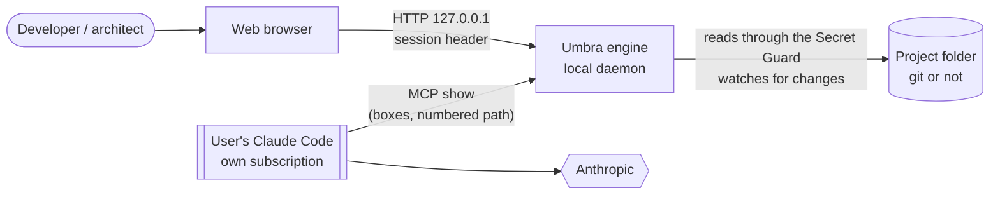
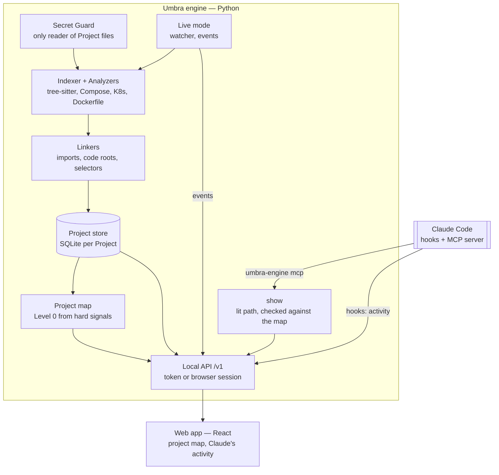

# Umbra — architecture (HLD)

Umbra lets someone who does not read code understand a software Project from end to end: what it does, how it is built, how a request travels through it, and what just changed. Everything runs on the user's machine. The engine never runs a model (ADR-0007, #114): the map comes from hard signals in the files, and the user's own Claude Code, in its terminal, lights its answers on the map through the MCP tool `show`.

## Context

- **Umbra sends nothing anywhere.** What leaves the machine is what the user's own Claude Code session sends to Anthropic, as in any Claude Code session.
- **No hosted mode, no telemetry, no API key.** The web app talks only to `127.0.0.1`.

## Containers

| Container | Responsibility | Decided in |
|---|---|---|
| Secret Guard | The only code that reads Project contents. Excludes sensitive files, masks secrets, judges links on both ends. | ADR-0004 |
| Indexer, Analyzers, Linkers | Facts read from the code (definitions, imports, declared services) with file, lines and version. Re-reads only changed files. | ADR-0001 |
| Project store | One SQLite file per Project: files, Claims (stable keys), Claude Code's activity, box places. | ADR-0002 |
| Project map | Level 0: ≤ 7 boxes, links and outputs built from hard signals, no LLM; `show` lights a path on it. | ADR-0007 |
| Live mode | Watches the Project, re-indexes, publishes events. Never runs a model. | SPEC S5 |
| Local API | `/v1` on 127.0.0.1: token for tools, one-time login for the browser (no cookie). | ADR-0002 |
| Web app | The project map, and what Claude Code did in the Project. | ADR-0007 |

## Key flows

**First look.** `umbra-engine start <folder>` → index (Guard → Analyzers → Linkers → store) → `/system` builds the Level 0 map from hard signals → the web app draws it. No model runs.

**A question in Claude Code.** Claude answers in ≤ 3 lines and calls `show` (MCP) → the engine checks every part against the map and the indexed files → event `show` → the open tab lights the numbered path.

**A file changes.** Watcher → re-index (only that file is read) → event `indexed` with the exact list → the page reads its map again.

**Show me the code.** A click on a step or a block → `/evidence` → the Guard reads the file again → the cited lines, with their version (commit or uncommitted) and a warning if the file changed since.

## Trust boundaries

1. **Project → Umbra**: the Secret Guard; nothing else opens Project files (enforced by a test that scans the engine's code).
2. **Claude Code → Umbra**: the MCP server only names boxes and repo paths; the engine refuses any part not on the map or not indexed. Umbra never starts `claude` (a test fails if any code path does).
3. **Browser → Umbra**: loopback host names only; one-time login code in the URL fragment; session secret in a header (cookies would reach other local servers).

## What is a Fact, what is not

| Kind | Where it comes from | Shown as |
|---|---|---|
| Fact | Read from the code by an Analyzer, with lines | solid |
| Declaration | Configuration (compose, manifests): not proof that it runs | dotted |
| Hypothesis | Name matching, or a deduced part of the map | dashed, "supposé" |
| Observation | Seen at run time (future: traces) | — |
