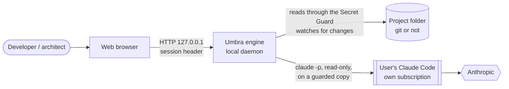
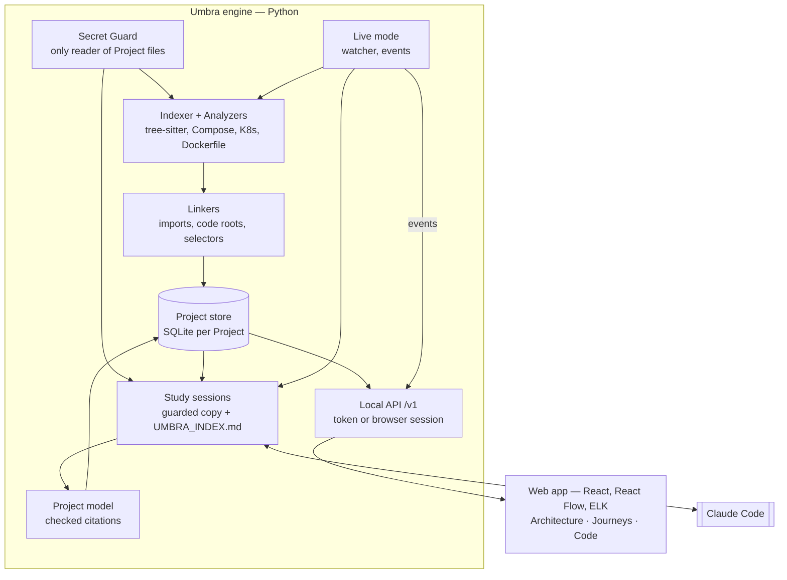

# Umbra — architecture (HLD)

Umbra lets someone who does not read code understand a software Project from end to end: what it does, how it is built, how a request travels through it, and what just changed. Everything runs on the user's machine; the only AI is the user's own Claude Code.

## Context

- **Nothing leaves the machine** except what the user's Claude Code sends to Anthropic: a guarded copy of the Project, never the Project folder itself (ADR-0003, ADR-0005).
- **No hosted mode, no telemetry, no API key.** The web app talks only to `127.0.0.1`.

## Containers

| Container | Responsibility | Decided in |
|---|---|---|
| Secret Guard | The only code that reads Project contents. Excludes sensitive files, masks secrets, judges links on both ends. | ADR-0004 |
| Indexer, Analyzers, Linkers | Facts read from the code (definitions, imports, declared services) with file, lines and version. Re-reads only changed files. | ADR-0001 |
| Project store | One SQLite file per Project: files, Claims (stable keys), cards, the Project model. | ADR-0002 |
| Study sessions | Claude Code studies a guarded copy with read-only tools, following an architect's method, and returns one model; updates re-read only changed files. | ADR-0005 |
| Live mode | Watches the Project, re-indexes, publishes events, triggers model updates. | SPEC S5 |
| Local API | `/v1` on 127.0.0.1: token for tools, one-time login for the browser (no cookie). | ADR-0002 |
| Web app | Three views of one understanding: architecture, journeys, code. | SPEC S2 |

## Key flows

**First look.** `umbra-engine serve` → index (Guard → Analyzers → Linkers → store) → study session: Umbra writes a guarded copy and its index, Claude Code reads it (map → entry points → journeys → components → modules) and returns the model → Umbra checks every cited file and line range → the web app shows the diagram, the journeys and the roles.

**A file changes.** Watcher → re-index (only that file is read) → event `indexed` with the exact list → update session told only those files → merged model → event `card` → the page refreshes and marks what changed.

**Show me the code.** A click on a step or a block → `/evidence` → the Guard reads the file again → the cited lines, with their version (commit or uncommitted) and a warning if the file changed since.

## Trust boundaries

1. **Project → Umbra**: the Secret Guard; nothing else opens Project files (enforced by a test that scans the engine's code).
2. **Umbra → Claude Code**: a temporary copy holding only released text, no assistant configuration; `--restricted`, `--strict-mcp-config`, read-only tools, no permission can be granted, API-key variables removed.
3. **Browser → Umbra**: loopback host names only; one-time login code in the URL fragment; session secret in a header (cookies would reach other local servers).

## What is a Fact, what is not

| Kind | Where it comes from | Shown as |
|---|---|---|
| Fact | Read from the code by an Analyzer, with lines | solid |
| Declaration | Configuration (compose, manifests): not proof that it runs | dotted |
| Hypothesis | Name matching, or Claude Code's reading (roles, journeys, diagram) | dashed, "Hypothèse" |
| Observation | Seen at run time (future: traces) | — |
